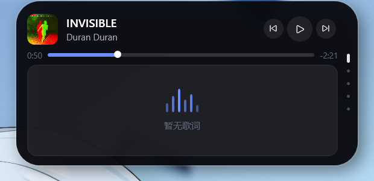

# 灵动岛 DynamicIsland

Windows 桌面顶部的灵动岛（Dynamic Island）：常驻胶囊 + 展开面板，聚合通知、媒体、歌词、天气、硬件与快捷启动。



## 功能

| 模块 | 说明 |
| --- | --- |
| **消息通知** | 读取 Windows 通知（QQ / 邮件 / 系统等），新消息自动弹出通知卡约 4 秒；通知卡和列表显示来源应用图标（取不到时用首字彩色占位）；点击通知可唤起来源应用；通知页支持一键清空 |
| **音乐控制** | 通过系统 SMTC 接管所有播放器（网易云 / QQ 音乐 / Spotify / 浏览器等）：播放暂停、上一首/下一首、进度显示；同时开着多个播放器时，媒体条出现「⇄」按钮切换接管来源 |
| **音量** | 展开态媒体条右侧有音量条：拖动调音量、单击静音，并弹出岛下方的音量浮层；折叠态滚轮同样可调（步进可在设置里改，默认 4%） |
| **歌词** | LRCLIB 自动匹配（同步歌词 / 纯文本歌词）：标题与艺人自动清洗，多级查询 + 时长/艺人评分；本地缓存，冷门歌也尽量回退到纯文本。新增独立歌词页：三行大字 + karaoke 逐字擦除 |
| **日期天气** | 顶部实时时钟；Open-Meteo 天气（温度 / 体感 / 湿度 / 风速 / 三日预报）；城市可在设置里选预设或搜索任意城市 |
| **硬件监视** | CPU、内存、GPU、磁盘占用与上下行网速，2 秒刷新，超 75% 转橙、超 90% 转红；每项带 28 点迷你趋势曲线 |
| **图标坞** | 把桌面快捷方式拖到岛上即可暂存，点击图标直接启动；拖拽图标可排序；右键图标可打开文件位置或移除 |
| **系统感知** | 麦克风橙点 / 摄像头绿点（读 ConsentStore 注册表，只在真实占用时点亮）；电源插拔、低电量、USB 插拔、Caps/Num Lock、勿扰模式变化时在岛下弹出系统浮层 |
| **全屏与快捷键** | 检测到真正的全屏应用（视频 / 游戏）自动隐藏，退出后恢复；`Ctrl+Alt+D` 随时隐藏/显示，隐藏时几乎零开销 |
| **蓝牙** | 蓝牙设备连接 / 断开时弹出设备名、类型和电量（BLE GATT 可读时） |
| **剪贴板** | 复制文字或图片时岛下弹出缩略预览；新增剪贴板页，保留最近 20 条，点击可复制回剪贴板 |
| **日历与专注** | 新增日历页（跟随系统日期，今日高亮）；右键菜单可启动 25 / 50 分钟专注或 5 分钟休息，折叠胶囊显示倒计时 |
| **设置面板** | 右键岛体 →「设置…」：主题、动画风格、天气城市（预设 / 搜索 / 经纬度）、模块开关、系统感知开关、歌词延迟补偿、音量步进、歌名跑马灯、开机自启、数据目录与日志入口，改动即时生效 |
| **折叠态** | 有歌词时胶囊上滚动当前歌词（可在设置里关掉）、右侧胶囊时钟；歌名/歌词过长时跑马灯；没有媒体时自动加宽，显示时钟 + 日期 + 天气 |
| **托盘** | 托盘图标：展开/收起、开机自启、打开日志、退出 |

## 使用

直接运行 `DynamicIsland.exe`（单文件，需 .NET 10 桌面运行时）。

> **首次运行**可能出现「打开文件 - 安全警告」（未签名程序的系统提示），点「运行」即可。

- **鼠标移到岛上**：自动展开（感应区比胶囊大一圈），并带约 3px 的下沉回弹
- **鼠标移开**：立即开始收起（约 0.2 秒动画）；如果收到一半又把鼠标移回来，
  会从当前尺寸和速度直接反向，不会跳变或重新播放淡入
- **右键岛体**：菜单（设置…、开机自启、专注 25/50/5、主题切换、刷新天气、清空图标坞、打开数据目录、打开日志、退出）
- **滚轮在展开的岛上**：切换 8 个页面（媒体 / 天气 / 硬件 / 图标坞 / 通知 / 歌词 / 剪贴板 / 日历），带果冻回弹动画
- **滚轮在折叠的岛上**：调节音量，岛下方弹出音量浮层
- **Ctrl+Alt+D**：立即隐藏 / 显示灵动岛（隐藏时窗口不可见，托盘图标仍在）
- **全屏应用**：看全屏视频或游戏时岛自动隐藏，退出全屏自动恢复；普通最大化窗口不会误触发
- **复制内容**：复制文字或图片后，岛下方弹出缩略预览，剪贴板页可查看历史并点击复制回
- **音量条**：展开态媒体页进度行右侧，拖动调节、单击静音
- **右侧分页点**：当前页拉长成胶囊并跟随切换弹簧，点击可切页
- **拖进度条**：点击或拖动跳转播放位置；右侧显示剩余时间（`-m:ss`），
  拖动时轨道加粗并出现强调色光晕，松手后保持选中位置直到播放器确认
- **拖文件到岛上**：加入图标坞；拖图标可调整顺序；右键图标 → 打开文件位置 / 从图标坞移除
- **点击图标**：启动该应用；若 4 秒内没有检测到程序启动，
  图标坞顶部会显示红色提示（快捷方式失效、被安全软件拦截或程序自身异常）
- **主题**：右键 → 主题，或在设置里切换，曜石 / 石墨 / 瓷白即时生效并记住

> 托盘图标也实现了（右键菜单同上），但它依赖 explorer 的托盘服务；
> 若任务栏右下角的 `^` 里找不到它，直接用**岛体右键菜单**，功能完全一致。

外部程序可通过窗口消息 `WM_COPYDATA` 控制（见 `tools/island_cmd.py`）：

```
expand | collapse | toggle | tab:0..5 | notify:标题|正文 | launcher:路径 | volume:0.5 | quit
```

## 设置面板

右键岛体 →「设置…」打开，改动即时写入 `settings.json`：

- **外观**：曜石 / 石墨 / 瓷白
- **动画**：标准（默认手感）/ 顺滑（临界阻尼、不回弹）/ 弹跳（明显 overshoot）/ 干脆（收放更快）；
  切换后立即作用于展开收起与切页弹簧
- **天气与位置**：12 个预设城市；也可输入城市名点「搜索」（Open-Meteo 地理编码），
  或直接手填经纬度
- **模块**：天气 / 硬件监视 / 歌词匹配 / 系统通知 四个开关
- **歌词与音量**：歌词延迟补偿（±50ms，范围 ±1500ms）、滚轮音量步进（1%–20%）、歌名跑马灯
- **启动**：开机自启
- **底部**：打开数据目录 / 打开日志 / 完成

## 启动器说明

图标坞里的 `.lnk` 优先由 Windows 打开原快捷方式，保留它的启动设置；原文件不存在时，
使用已保存的目标、参数和工作目录回退。若快捷方式和软件都已移动或删除，需要重新拖入
当前有效的快捷方式。点击无法启动时会提示原因及日志路径；日志中的“已提交启动请求”
表示 Windows 已接受调用，不表示应用窗口一定已经出现。

需要重新构建或运行启动器专项测试时，在项目根目录执行（需要 .NET 10 SDK）：

```powershell
dotnet build .\src\DynamicIsland\DynamicIsland.csproj -c Debug
dotnet run --project .\src\DynamicIsland.SelfTest\DynamicIsland.SelfTest.csproj -- --launcher-test
```

发布单文件（本机 SDK 在 `D:\dotnet-sdk`）：

```powershell
$env:DOTNET_ROOT="D:/dotnet-sdk"
dotnet publish .\src\DynamicIsland\DynamicIsland.csproj -c Release -r win-x64 `
  --self-contained false -p:PublishSingleFile=true -o .\publish-out
```

专项测试使用独立临时目录和自行启动后立即退出的测试进程，不修改正式图标坞配置，不执行音量、通知、媒体和天气自检。

## 数据目录

| 内容 | 路径 |
| --- | --- |
| 配置 / 图标坞 | `%APPDATA%\DynamicIsland\settings.json` |
| 歌词缓存 / 日志 | `%LOCALAPPDATA%\DynamicIsland\` |

可用环境变量 `DYNAMICISLAND_DATA_DIR` 覆盖（便携 / 调试用）。

## 技术栈

- **.NET 10 + WPF**，Win32 互操作做异形透明窗与逐像素区域穿透
- **自研弹簧动画引擎**：`CompositionTarget.Rendering` 逐帧积分（宽 / 高 / 圆角 / 纵向轻弹四通道），
  可随时打断并保留速度；展开用略欠阻尼、收起用更紧的阻尼，形状变化带轻微 overshoot
- **展开/收起交叉淡入**：按岛体高度做 smoothstep 渐变，展开内容同时做 7px 渐进归位，变形过程不硬切
- **页面切换弹簧**：一个连续的 tab 位置驱动 6 个页面滑动/缩放/淡入，欠阻尼回弹（果冻感），
  分页点跟随位置并随速度拉伸；快速连滚时弹簧保留动量继续追赶
- **主题系统**：曜石 / 石墨 / 瓷白三套调色板，颜色统一走 `DynamicResource`，切换即时生效并持久化
- **封面 morph**：折叠 24px 正圆 ↔ 展开 46px 圆角方形，由岛体高度连续插值尺寸与位置
  （圆角固定 12，尺寸变大时形状自然从圆过渡到圆角方）；
  折叠/展开两套模板只保留布局占位，真正的封面由顶层 morph 层绘制，不会出现两个封面叠影
- **封面取色**：解码 24px 缩略图，按鲜艳度加权平均、跳过近黑近白与灰像素，
  再按当前主题明暗钳制饱和度/亮度；换歌与换主题时以 300ms 半衰期指数过渡，
  用 `DispatcherTimer` 驱动（渲染回调在窗口空闲时会停）
- **动画风格预设**：标准 / 顺滑 / 弹跳 / 干脆四档，对刚度与阻尼做不同乘数，
  同时作用于岛体尺寸弹簧与切页弹簧，设置面板切换即时生效
- **GSMTC**（WinRT）接管媒体（支持多会话切换），**Core Audio** 控音量
- **系统感知**：隐私点读 `CapabilityAccessManager\ConsentStore`（校验 start/stop 时间戳）；
  Caps/Num Lock、电源、勿扰走轻量轮询；USB 走 `WM_DEVICECHANGE`；
  蓝牙用 WinRT `DeviceWatcher` + BLE GATT 电池服务；剪贴板用 `AddClipboardFormatListener`
- **全屏检测**：前景窗口矩形覆盖监视器且没有 `WS_MAXIMIZE` 才算全屏（最大化窗口不误判）；
  隐藏用 `Window.Hide()`，恢复用 `Show()`；全局快捷键 `RegisterHotKey`
- **专注计时**：独立服务 + 1 秒 tick，结束时用系统浮层提醒
- **剪贴板历史**：文本 / 图片（PNG 字节）最近 20 条，去重后入列，点击回写 `Clipboard.SetText/SetImage`
- **karaoke 歌词**：按当前行内进度生成 LinearGradientBrush，已唱部分强调色、未唱部分次要色，
  擦除边界叠一条提亮的柔和光带（宽度约占行宽 4.5%）
- **图标坞启动**：优先用 Windows 打开原 `.lnk`（保留参数/工作目录/提权语义），
  目标缺失时回退已保存路径；启动前清理宿主继承的 `ELECTRON_RUN_AS_NODE` 等变量，
  避免 Electron 应用（VS Code、EchoMusic 等）被误当成 Node 进程启动
- **图标坞排序**：鼠标捕获 + 命中测试实现，不依赖 OLE 拖放，拖出图标范围也能正确落位
- **通知来源解析**：handlerId → 运行中进程 exe（含别名表），取真实图标并支持点击拉起；
  打包应用走 `shell:AppsFolder\<AUMID>`
- **歌词时间轴**：用 timeline 的 `LastUpdatedTime` 补偿播放器上报延迟；450ms 的媒体快照之间
  再按本地时钟外推位置（`TrackInfo.PositionCapturedAt`），歌词涂色与进度条每 200ms 连续前进，
  不会一顿一顿地跳
- **LRCLIB** 歌词、**Open-Meteo** 天气与地理编码（均免 Key）
- **wpndatabase.db 只读解析**获取系统通知（绕开未打包应用的授权限制）
- **硬件监控**：`GetSystemTimes` + `GlobalMemoryStatusEx` + PDH GPU 计数器 + `NetworkInterface`
- 固定窗口 + 内部尺寸动画；`WM_NCHITTEST` 返回 `HTTRANSPARENT` 实现岛外点击穿透，
  右键菜单打开时把菜单矩形并入命中区（否则菜单下半截点不到）

## 性能

| 指标 | 实测（Release 单文件，2560×1600@150%） |
| --- | --- |
| 常驻内存 | 启动 ~183 MB，长时间运行稳定不增长 |
| 空闲 CPU | 接近 0%（媒体 900ms 轮询、歌词 200ms、硬件 2s） |
| 启动耗时 | ~3 秒完成媒体/通知/天气初始化 |

## 已知限制

- 系统通知走数据库读取，非官方 API，Windows 大版本升级后可能失效
- 歌词依赖 LRCLIB 曲库，冷门歌曲可能匹配不到；此时歌词页显示「暂无歌词」，媒体页显示动态频谱
- 播放器若不上报 SMTC（如部分老版本客户端、Windows Media Player 旧组件），媒体信息会为空
- 多播放器来源切换仅在同时存在多个 SMTC 会话时出现
- 点击通知唤起来源应用依赖「来源标识 → 进程」解析；系统类通知不响应点击
- 蓝牙电量依赖 BLE GATT 电池服务，部分经典蓝牙设备读不到电量（仍会显示连接/断开）
- 勿扰状态通过注册表 `NOC_GLOBAL_SETTING_TOASTS_ENABLED` 近似检测，个别系统版本可能读不到
- 全屏检测只认「覆盖屏幕且非最大化」的窗口；某些全屏壳/游戏可能被当作普通窗口
- 隐私点依赖 Windows 隐私记录，个别应用不写记录时可能不亮
- 需 .NET 10 桌面运行时（`Microsoft.WindowsDesktop.App 10.x`）
- 单文件仅框架依赖，未做代码签名
